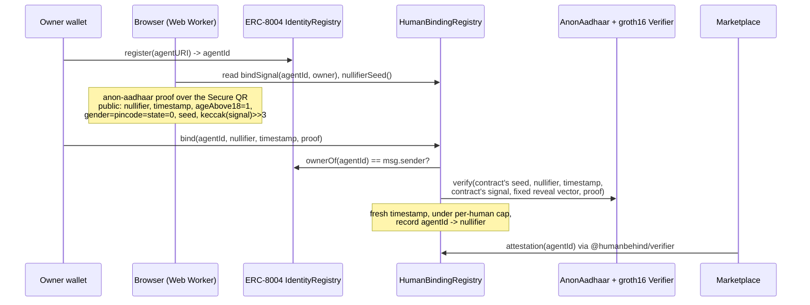

# Human Behind the Agent

A real, unique, adult Indian resident proves they own an AI agent, revealing
zero personal data. The proof is an [anon-aadhaar](https://github.com/anon-aadhaar/anon-aadhaar)
zero-knowledge proof over the Aadhaar Secure QR, bound on-chain to the agent's
[ERC-8004](https://eips.ethereum.org/EIPS/eip-8004) identity. Built for agent
marketplaces that want "one human, N agents, accountable" without holding KYC data.

```ts
await isHumanBacked(agentId, { client, registry }); // true | false
```

> [!WARNING]
> **Test Aadhaar data only. Unaudited.** Everything here runs on UIDAI's
> published sample resident (a fictitious person) re-signed with
> anon-aadhaar's public test key, on local chains. No real Aadhaar data is
> used, requested or stored. Do not point it at real QRs or gate anything of
> value with it yet.

## Demo output

A real run of `pnpm e2e` (headless, own anvil, real groth16 proofs), captured
on 2026-10-04 on an Apple M4 (10 cores), Node 22.14:

```text
== deploy (TEST anchor)
  ok  registry reports test anchor
== register ERC-8004 agent
  ok  alice owns agent #1
== read bind signal from chain, cross-check with off-chain computation
  ok  on-chain bindSignal == computeBindSignal
== mint TEST QR + prove (real groth16, multi-thread node)
  proving time: 29569 ms
== bind
  estimated gas: 405919
== verifier lib
  ok  isHumanBacked() is FALSE by default for a test-anchor registry (fail closed)
  ok  isHumanBacked(allowTestAnchor) is true
  ok  attestation records nullifier + 18+
  verdict without test allowance: registry trusts the public TEST key; not a real-human proof
  ok  card claim verifies against trusted registry
  ok  card cannot lend its binding to a different agentId
  ok  card claim pointing at an untrusted registry is ignored
== Sybil cap = 2: same human, second agent ok, third rejected
  proving time: 27065 ms
  ok  same human => same nullifier across agents
  proving time: 34299 ms
  ok  third agent (even from another wallet) rejected with HumanAgentLimit
== transfer kills the badge
  ok  after transfer, agent is no longer human-backed

E2E PASSED
```

## Why

ERC-8004 gives an agent an on-chain identity, but nothing says who is
accountable for it. Spinning up a thousand "independent" agents costs one
script, so marketplaces either run KYC and sit on personal data, or accept
Sybil farms. India has about 1.3 billion Aadhaar holders and a UIDAI-signed
offline QR that anon-aadhaar can prove over in zero knowledge, so a
marketplace can learn "this agent is backed by a unique adult who backs at most
N agents here" and nothing else.

This repo also fixes a real bug from its predecessor (zkdir), where the server
trusted a client-sent `useTestAadhaar` flag, so anyone could forge proofs with
the public test key. Here no client input can choose the trust anchor.

## Quickstart

Requires Node 22, pnpm 9 (`corepack enable`) and [Foundry](https://getfoundry.sh).

**1. Install, test, build** (no circuit download needed, about a minute):

```bash
git clone https://github.com/agnij-dutta/humanbehind && cd humanbehind
pnpm install
pnpm build:packages
cd contracts && forge build && forge test && cd ..   # 42 tests incl. real groth16 proofs
pnpm test:packages                                     # signal encoding + verifier policy
pnpm --filter web build
```

**2. Full flow with real proving** (downloads 612 MB of circuit artifacts):

```bash
pnpm artifacts                 # .artifacts/{aadhaar-verifier.wasm,circuit_final.zkey,vkey.json}
node scripts/export-abi.mjs    # scripts/artifacts.json (bytecode for deploy)
pnpm e2e                       # headless, spawns its own anvil on :8546
```

**3. The web app** on a local chain:

```bash
anvil                                                   # terminal 1, :8545
pnpm tsx scripts/deploy.ts                              # terminal 2: deployments/local.json + apps/web/.env.local
pnpm --filter web link-artifacts                        # hard-links .artifacts into public/ (no copy)
pnpm --filter web build && pnpm --filter web start      # http://localhost:3100
```

Then: connect "Anvil dev #1", register an agent, mint a TEST QR, prove (about
2 minutes in the browser), bind, open the agent page.

## Usage

### Verifier library (`@humanbehind/verifier`)

| Export                           | What it does                                                                          |
| -------------------------------- | ------------------------------------------------------------------------------------- |
| `isHumanBacked(agentId, opts)`   | Boolean verdict from chain state. Fails closed on any error.                          |
| `getHumanBacking(agentId, opts)` | Raw attestation: nullifier, bound owner, timestamps, agents for this human.           |
| `evaluate(backing, policy)`      | Pure policy check, returns `{ ok, reasons }` so you can show why.                     |
| `verifyCardClaim(card, opts)`    | Checks a registration file's `humanBacking` entries, only for the agent you resolved. |
| `humanBackingFromCard(card)`     | Extracts well-formed `humanBacking` entries (discovery hints, never proof).           |
| `parseCaip10(id)`                | Parses `eip155:<chainId>:<address>`.                                                  |

| Option              | Default      | Meaning                                                                    |
| ------------------- | ------------ | -------------------------------------------------------------------------- |
| `client`            | required     | viem `PublicClient`.                                                       |
| `registry`          | required     | The `HumanBindingRegistry` you trust. Pin it in config, never from a card. |
| `identityRegistry`  | unset        | Fail unless the binding registry serves this ERC-8004 identity registry.   |
| `allowTestAnchor`   | `false`      | Accept registries anchored to the public test key. Dev only.               |
| `requireAdult`      | `true`       | Require the 18+ claim.                                                     |
| `maxAgentsPerHuman` | unset        | Stricter than the registry, e.g. `1` = "this human has no other agents".   |
| `maxBindingAgeSec`  | unset        | Reject old bindings, forcing periodic re-proof.                            |
| `now`               | `new Date()` | Clock override for tests.                                                  |

`verifyCardClaim` additionally requires `agentId`, `identityRegistry` and
`trustedRegistries`.

### Core package (`@humanbehind/core`)

`@humanbehind/core` exports the ABIs, `computeBindSignal`, `computeRevokeSignal`,
`anonAadhaarSignalHash`, `packGroth16Proof` and proof JSON helpers;
`@humanbehind/core/prover` exports `proveBinding` (Node and Web Worker);
`@humanbehind/core/testqr` exports `mintTestQr` (Node only, public test key).
See [packages/core/README.md](packages/core/README.md).

### Contract (`HumanBindingRegistry`)

| Function                                                  | Who            | Purpose                                                              |
| --------------------------------------------------------- | -------------- | -------------------------------------------------------------------- |
| `bindSignal(agentId, owner)` / `revokeSignal(agentId)`    | anyone (view)  | The signal a proof must commit to.                                   |
| `bind(agentId, nullifier, timestamp, proof)`              | agent owner    | Bind the agent to the human behind the proof.                        |
| `revokeByOwner(agentId)`                                  | agent owner    | Drop the binding.                                                    |
| `revokeByHuman(agentId, nullifier, timestamp, proof)`     | anyone (relay) | The same human revokes with a fresh proof, no wallet needed.         |
| `pruneStale(agentId)`                                     | anyone         | Clear a binding whose agent changed hands, freeing the human's slot. |
| `isHumanBacked(agentId)` / `attestation(agentId)`         | anyone (view)  | Live binding state.                                                  |
| `setMaxAgentsPerHuman`, `setMaxProofAge`, `transferAdmin` | admin          | Policy knobs only. Anchor and seed are immutable.                    |

### HTTP routes (web app)

| Route                     | Purpose                                                                     |
| ------------------------- | --------------------------------------------------------------------------- |
| `GET /api/agent/:id`      | JSON verdict; `humanBackedStrict` is what a marketplace should use.         |
| `GET /api/agent/:id/card` | ERC-8004 registration file with the `humanBacking` extension.               |
| `POST /api/dev/test-qr`   | TEST QR minting. 404 unless `HB_DEV_MODE=true`; 409 on a production anchor. |

### Scripts

| Command                           | What                                                                        |
| --------------------------------- | --------------------------------------------------------------------------- |
| `pnpm test`                       | package tests then forge tests                                              |
| `pnpm lint` / `pnpm format`       | ESLint (zero warnings) / Prettier + `forge fmt`                             |
| `pnpm build`                      | packages + web app                                                          |
| `pnpm artifacts`                  | download circuit artifacts                                                  |
| `pnpm e2e`                        | headless full flow with real proofs                                         |
| `pnpm fixture`                    | regenerate the real-proof forge fixture                                     |
| `node scripts/browser-e2e.mjs`    | drive the real UI in headless Chromium (needs `CHROME`, see `.env.example`) |
| `pnpm tsx scripts/minor-check.ts` | show that an under-18 TEST QR cannot yield a submittable proof              |

### Environment variables

Every variable is listed with comments in [`.env.example`](.env.example).

| Variable                                          | Used by        | Purpose                                                             |
| ------------------------------------------------- | -------------- | ------------------------------------------------------------------- |
| `NEXT_PUBLIC_CHAIN_ID`                            | web            | Chain id (31337 = anvil).                                           |
| `NEXT_PUBLIC_RPC_URL`                             | web            | JSON-RPC endpoint (public, so never a keyed URL).                   |
| `NEXT_PUBLIC_IDENTITY_REGISTRY`                   | web            | ERC-8004 identity registry address.                                 |
| `NEXT_PUBLIC_BINDING_REGISTRY`                    | web            | `HumanBindingRegistry` address.                                     |
| `NEXT_PUBLIC_ARTIFACTS_BASE`                      | web            | Where the browser fetches circuit artifacts.                        |
| `NEXT_PUBLIC_DEV_MODE`                            | web            | UI affordances only (TEST QR button, anvil wallet). Grants nothing. |
| `HB_DEV_MODE`                                     | web server     | Enables the TEST QR endpoint.                                       |
| `NEXT_DIST_DIR`                                   | web build      | Alternate Next.js build directory.                                  |
| `RPC_URL`                                         | `deploy.ts`    | Deploy target (anvil dev key, local only).                          |
| `IDENTITY_REGISTRY`, `ANON_AADHAAR`, `MAX_AGENTS` | `Deploy.s.sol` | Reuse contracts, set the cap.                                       |
| `BASE`, `OUT`, `CHROME`                           | `browser-e2e`  | Target URL, screenshot dir, Chromium path.                          |

## How it works



The signal is `keccak256(BIND_DOMAIN, chainid, registry, identityRegistry,
agentId, owner, nonce)`, computed by the contract. The caller only supplies
`nullifier`, `timestamp` and the proof. The proving runs entirely on the
user's device; the QR never leaves it.

Design decisions:

- **The trust anchor is not a parameter.** `AnonAadhaar.sol` stores the RSA
  key hash as an immutable. The registry reads it once at deploy, exposes
  `isTestAnchor()`, and refuses to deploy if the anchor is neither the UIDAI
  nor the test key, or differs from what the deployer declared. The
  deployer's flag can only make deployment fail, never relabel an anchor
  (`testFuzz_anchorReadFromVerifierNotFlag`). A real test-key proof fails on a
  production-anchored deployment (`test_real_testProofRejectedByProductionDeployment`).
- **The contract supplies the seed, the signal and the reveal vector.** A user
  can't pick another nullifier seed to become a fresh human, reuse a proof for
  another agent, owner, chain or registry, or submit a proof that reveals
  gender, state or pincode (it won't verify).
- **Nonce in the signal.** Every bind and revoke bumps `nonceOf[agentId]`, so
  a proof that was public in calldata can't be replayed after a revoke.
- **Transfer kills the badge.** `isHumanBacked` requires the current NFT owner
  to equal the address that bound it.
- **Human-initiated revocation.** `revokeByHuman` takes a fresh proof from the
  same nullifier over `revokeSignal(agentId)`. Anyone can relay it, so a human
  whose wallet was stolen can still pull their name off the agent.
- **Gas cap on verification.** A malformed proof makes the pairing precompile
  burn all forwarded gas (about 1B gas observed in a test), so the verifier
  call is capped at 1M gas and a revert counts as an invalid proof.

### What was verified, and how

| Claim                | Evidence                                                                                                                                                                                                                                                                                                          |
| -------------------- | ----------------------------------------------------------------------------------------------------------------------------------------------------------------------------------------------------------------------------------------------------------------------------------------------------------------- |
| Registry logic       | 34 forge tests with a mock verifier that accepts only exact public inputs: replay across agent, chain, registry, nonce and after revoke; other seed; leaky reveal vector; minor; expiry; future timestamp; cap across wallets; stale slots; transfer; front-running; anchor fuzz; fail closed on verifier revert. |
| Real proofs verify   | 8 forge tests against the real anon-aadhaar groth16 verifier with real proofs from `pnpm fixture`, including a test-key proof rejected by a production-anchored deployment.                                                                                                                                       |
| Off-chain code       | 21 `node:test` tests: signal encoding matches the on-chain fixture, verifier policy, card claims that try to borrow another agent's badge.                                                                                                                                                                        |
| Full flow on a chain | `pnpm e2e` (output above).                                                                                                                                                                                                                                                                                        |
| The real web UI      | `scripts/browser-e2e.mjs` drove headless Chromium through register, mint TEST QR, prove in a Web Worker, bind, badge page.                                                                                                                                                                                        |
| Minors can't bind    | `scripts/minor-check.ts`: a DOB-2015 TEST QR yields `ageAbove18 = 0` and the prover refuses to emit a submittable proof.                                                                                                                                                                                          |

Proving time, Apple M4 (10 cores), Node 22, local artifacts:

| Setup                                                 | Time                                         | Measured                                   |
| ----------------------------------------------------- | -------------------------------------------- | ------------------------------------------ |
| Node, multi-thread (`pnpm e2e`, 3 proofs)             | 27.1 s, 29.6 s, 34.3 s                       | 2026-10-04, `provingMs` from the prover    |
| Node, multi-thread (5 runs, earlier session)          | 73 to 105 s                                  | 2026-10-04, same machine, under other load |
| Node, single-thread                                   | 195 s                                        | 2026-10-04, same machine                   |
| Browser: headless Chromium, Web Worker, single-thread | 123.5 s                                      | 2026-10-04, `browser-e2e.mjs`              |
| `bind` gas including groth16 verify                   | about 375k (forge), 405,919 (anvil estimate) | 2026-10-04                                 |

Times are wall clock for `snarkjs.groth16.fullProve` only, excluding artifact
loading. The spread between multi-thread runs tracks machine load.

## Security model and limitations

### What a live binding proves

- At bind time, someone **holding a UIDAI-signed Aadhaar Secure QR** produced
  a proof for exactly this agent, owner wallet, chain and registry.
- The QR's date of birth is 18+ **as of the QR's signing time**.
- The QR was signed within `maxProofAge` (default 1 day) of binding. UIDAI
  signs the timestamp, so it can't be backdated.
- Within this registry, that QR's holder backs at most `maxAgentsPerHuman`
  live agents, however many wallets they use. Bindings whose agent changed
  hands keep the slot until anyone calls `pruneStale`.
- The agent token has not changed hands since.

### What it does not prove

- **That the person is the Aadhaar holder.** The circuit proves possession of
  a signed QR, not presence of the person. No liveness, no face match.
  Freshness helps: an old printout or a hotel's photocopy carries an old
  timestamp and is rejected. A fresh QR needs the mAadhaar app or a
  resident-portal download, both gated by an OTP to the registered mobile, so
  "fresh QR" roughly means "controls the registered mobile number today".
- **That the human still controls the agent.** The human can hand the agent to
  someone else. Selling the NFT drops the badge; selling the private key does
  not. A human can also run an agent for someone else ("rent-a-human"). The
  cap bounds how many agents one Aadhaar can lend its name to; it does not
  stop lending. `maxBindingAgeSec` lets marketplaces force periodic re-proof.
- **Real-world identity or recourse.** Accountability is pseudonymous: the
  registry can tell "these 3 agents share a human", not who that human is.

### Privacy and linkability

- **On-chain per binding:** nullifier, QR timestamp (hour precision, i.e. when
  you downloaded your QR), owner address. Name, Aadhaar number, gender, state,
  pincode and photo are never revealed; the reveal vector is fixed in the contract.
- **Within one registry, all agents of a human are linkable** via the
  nullifier. That is the point of "one human, N agents".
- **Nullifier linkability across apps.** Different apps use different
  `nullifierSeed`s, so two apps can't join their users by nullifier alone. But
  the seed is public, so anyone holding your QR data can compute your
  nullifier for every app.
- **Anyone who has ever scanned your QR can find your agents.** The nullifier
  is a hash of the seed and the QR photo. Hotels, SIM shops and landlords
  routinely scan Aadhaar QRs; any of them can compute your nullifier here and
  list every agent you back. This is inherent to deterministic nullifiers over
  data third parties hold.
- **Photo updates mint new humans.** The nullifier is `hash(seed, photo)`
  (circuit `helpers/nullifier.circom`), so a photo update at an enrolment
  centre yields a new nullifier and a fresh set of slots. Slow and expensive,
  but a real Sybil path.
- A bound wallet is linkable to everything else it does. Use a dedicated owner wallet.

### Offline-KYC realities

- **UIDAI key rotation.** UIDAI published a new offline-KYC certificate dated
  17-02-2026. `AnonAadhaar.sol` stores a single key hash and
  `PRODUCTION_PUBKEY_HASH` here is the 2021 key, so QRs signed with the new key
  will not verify on a 2021-anchored deployment. Production needs one verifier
  per anchor and a registry that accepts a fixed set (still not caller-selectable).
- **QR availability.** Users download the Secure QR from mAadhaar or the
  resident portal; the flow assumes a phone and a working registered mobile.
- **Regulation.** Offline Aadhaar verification by businesses has its own rules
  (UIDAI offline verification regulations, the DPDP Act). This repo stores no
  Aadhaar numbers or QR data, but check the current position before any
  production use. Not legal advice.

### Trust assumptions

- **UIDAI's signing key** and the anon-aadhaar **circuit and groth16 trusted
  setup** (PSE ceremony). A circuit soundness bug breaks everything here.
- **The deployment.** The registry trusts whichever `AnonAadhaar` contract it
  was deployed with and only checks its key hash. A malicious deployer could
  pass a fake verifier that reports the UIDAI hash and accepts anything.
  Consumers who pin a registry must also check its `anonAadhaar()` contract and
  that contract's groth16 `verifier()` against the upstream bytecode.
- **Test anchor.** The test key is public, so a test-anchored registry proves
  nothing about real people. Mitigations: anchor immutable and checked at
  deploy; `isTestAnchor()` on-chain; the verifier library treats test anchors
  as not human-backed unless `allowTestAnchor: true`; the badge page labels
  test bindings; the TEST QR endpoint is gated on the server-only `HB_DEV_MODE`
  and refuses to serve against a production-anchored registry.
- **Admin** can change the per-human cap and the max proof age (bounded to 30
  days), not the anchor, seed or bindings. A compromised admin can raise the
  cap and weaken Sybil resistance; use a multisig or timelock in anything real.
- **No server in the trust path.** The web server mints test QRs (dev only)
  and renders read-only pages from chain state. Marketplaces should read the
  chain through the verifier library, not the app's HTML or JSON.
- **Agent cards are untrusted.** A card can point at a fake registry that
  always says yes, or at a real registry entry for someone else's agent.
  Consumers pin the registry, and `verifyCardClaim` checks only the agentId
  and identity registry the caller resolved.
- **Front-running.** `bind` requires `msg.sender == ownerOf(agentId)` and the
  signal includes the owner, so a mempool observer can't use a pending proof.
  `revokeByHuman` is relayable by design; the nonce stops replays.

## Prior art and related work

- [anon-aadhaar](https://github.com/anon-aadhaar/anon-aadhaar) (PSE): the
  circuit, verifier and prover this builds on. This repo adds an
  agent-binding registry with a contract-enforced disclosure policy, nonce'd
  signals and a per-human cap.
- [ERC-8004 Trustless Agents](https://eips.ethereum.org/EIPS/eip-8004): agent
  identity, reputation and validation registries. This repo proposes a
  [`humanBacking` registration-file extension](docs/agent-card-extension.md)
  ([JSON Schema](docs/humanBacking.schema.json)).
- [World ID](https://world.org/world-id): proof of personhood via iris
  biometrics and dedicated hardware. Aadhaar reuses an identity system that
  already covers most of India's adults.
- [Self](https://self.xyz) and [zkPassport](https://zkpassport.id):
  passport NFC proofs. Similar shape for people with e-passports, a much
  smaller set in India.
- [Human Passport](https://passport.human.tech) (formerly Gitcoin Passport):
  stamp-based Sybil scoring. Probabilistic rather than one credential per human.

## Roadmap

- Production QR path: QR image upload and scan, UIDAI certificate selection,
  and a multi-anchor registry for the 2021 and 2026 UIDAI keys.
- Chunked zkey loading so the browser does not hold a 612 MB buffer, plus
  caching across sessions.
- ERC-8004 Validation Registry bridge: post `validationResponse` with tag
  `human-backed` on bind and revoke.
- Admin behind a timelock; an events indexer for the agent page.
- Testnet deployment (Fuji or Sepolia) with the test anchor.
  `contracts/script/Deploy.s.sol` is ready but only dry-run locally.
- On-chain or library-side check of the `AnonAadhaar` and groth16 verifier
  bytecode, so pinning a registry is enough.
- An external audit before any real-data use.

## Repository layout

| Path                | What                                                                                                                      |
| ------------------- | ------------------------------------------------------------------------------------------------------------------------- |
| `contracts/src/`    | `HumanBindingRegistry`, minimal ERC-8004 `AgentIdentityRegistry`, vendored anon-aadhaar (`@anon-aadhaar/contracts@2.4.3`) |
| `packages/core`     | ABIs, signal encoding, prover, TEST QR minting                                                                            |
| `packages/verifier` | Consumer library, viem peer dependency only                                                                               |
| `apps/web`          | Next.js 14 app: wallet, agent registration, TEST QR, browser proving, bind, badge page                                    |
| `scripts/`          | deploy, e2e, fixture generation, ABI export, artifact download                                                            |
| `docs/`             | `humanBacking` extension proposal and JSON Schema                                                                         |
| `dev-fixtures/`     | Public anon-aadhaar test key and UIDAI's fictitious sample QR. Not secrets, see its README.                               |

## Contributing

See [CONTRIBUTING.md](CONTRIBUTING.md). Report vulnerabilities privately, see
[SECURITY.md](SECURITY.md). Changes are tracked in [CHANGELOG.md](CHANGELOG.md).

## License

[MIT](LICENSE)

## Author

Agnij Dutta ([@0xholmesdev](https://x.com/0xholmesdev),
[github.com/agnij-dutta](https://github.com/agnij-dutta))
